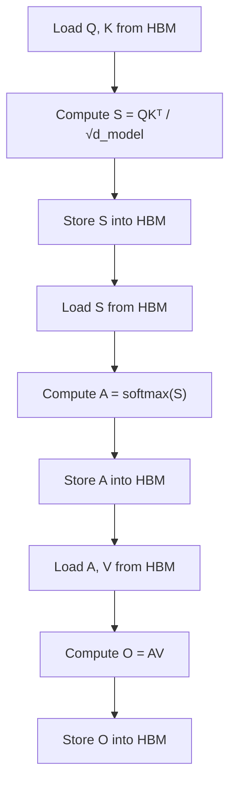

Video Ref: https://www.youtube.com/watch?v=gBMO1JZav44

Standard attention implemented naively is highly inefficient and slow. 

Computing:
$$
\text{Attention}(Q, K, V) = \text{softmax}(\frac{QK^\top}{\sqrt d_{\text{model}}})V
$$

Requires the following steps:

