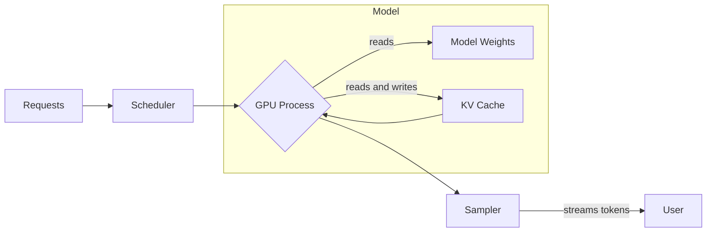

Deploying AI models is called **inference**. A common way to provide access to models is with an API, which we can implement as an **inference server** which implements a standard protocol like the OpenAI API.

On a high level, we have **requests** from users that flows into a **scheduler** (which decides how they should be batched and processed). Then the batches get executed on the GPU (using model weights and previous state like KV cache), and the model state (like KV cache) is updated. Lastly, for autoregressive models like LLMs, a sampler takes the probability distribution and samples the next token.

## 